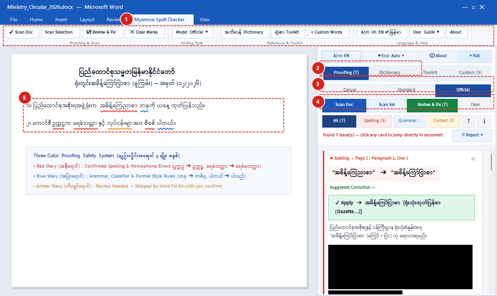
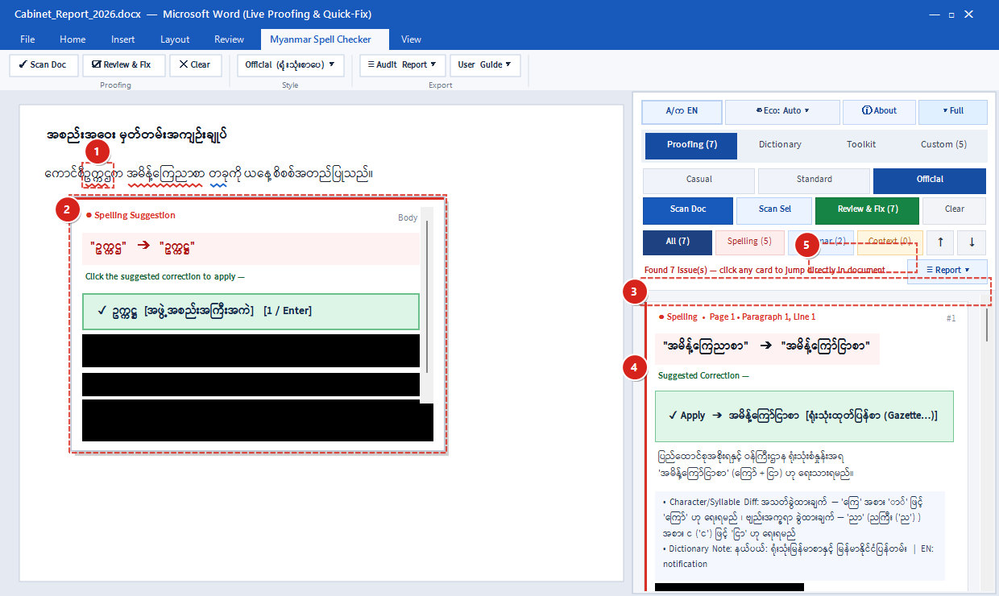
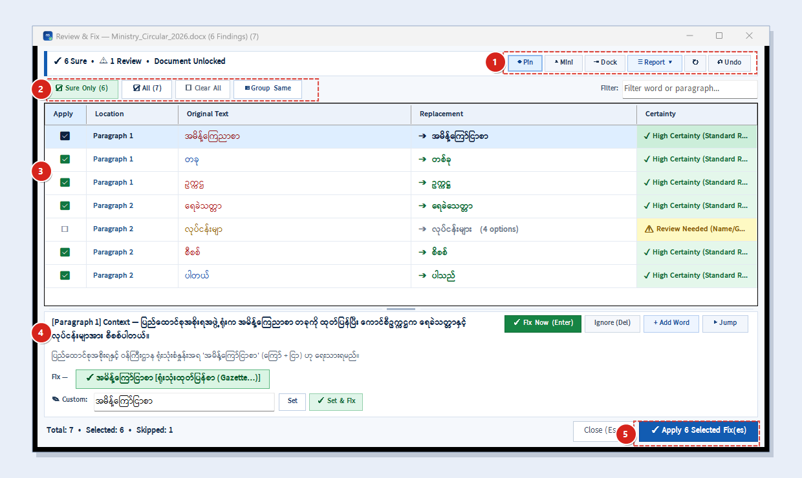
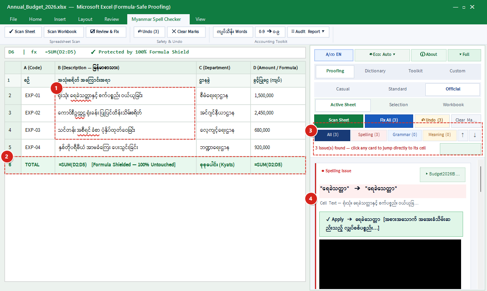
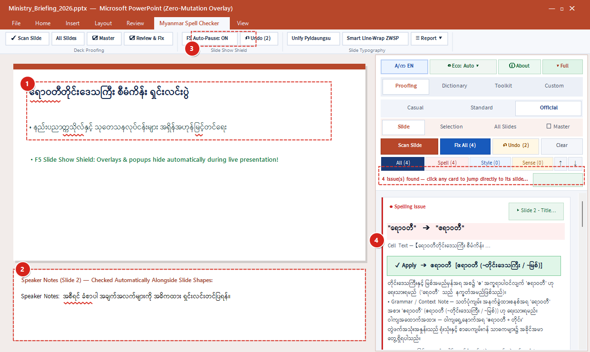
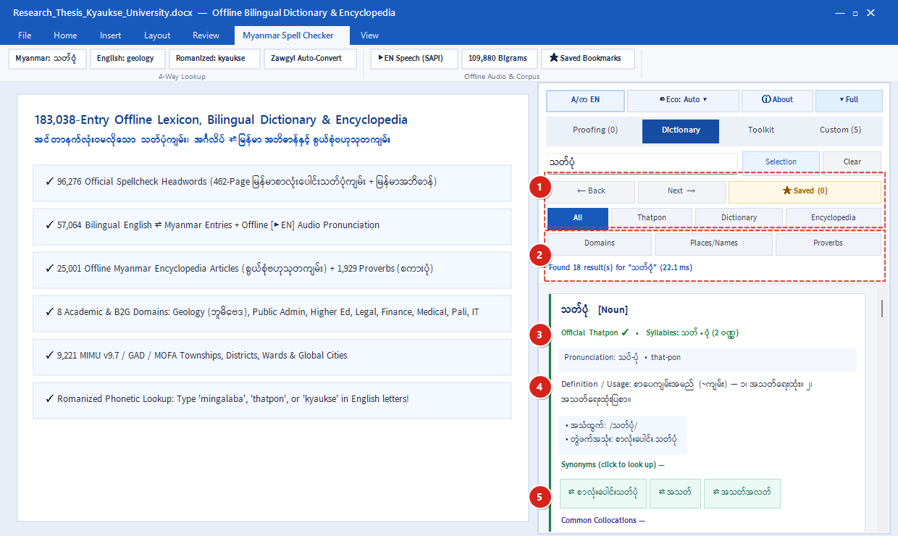
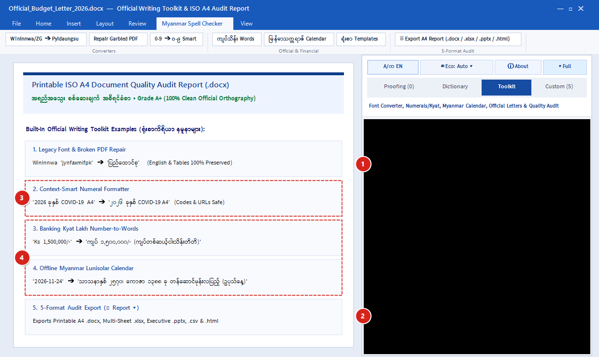
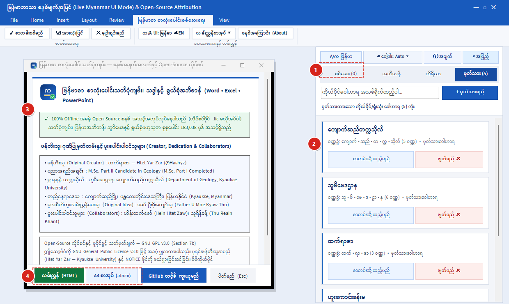

# Myanmar Spell Checker — Complete Illustrated User Guide & Architecture Handbook
## မြန်မာစာ စာလုံးပေါင်းစစ်ဆေးရေး — ပုံနှင့်တကွ အသုံးပြုပုံလမ်းညွှန်အပြည့်အစုံ (Word • Excel • PowerPoint)

> **100% Offline Unified 3-in-1 Microsoft Office Suite** (`Word + Excel + PowerPoint`, `.NET Framework 4.8`)  
> **Author:** **Htet Yar Zar (ထက်ရာဇာ)** — Department of Geology, Kyaukse University, Kyaukse, Myanmar  
> **Special Dedication:** **U Moe Kyaw Thu (ဦးမိုးကျော်သူ)** • **Collaborators:** **Hein Htet Zaw (ဟိန်းထက်ဇော်)** & **Thu Reain Khant (သူရိန်ခန့်)**  
> **License:** GNU GPL v3.0 + Mandatory Section 7(b) Attribution (`183,038` Compiled Entries • Zero Internet Calls)

## Table of Contents / မာတိကာ
- [**01. Quick-Start & 1-Click Offline Installation** — *အမြန်စတင်အသုံးပြုနည်းနှင့် Offline ထည့်သွင်းနည်း*](#quick-start)
- [**02. Complete Directory of Available Tools (28 Built-In Tools)** — *ပါဝင်သော ကိရိယာများ အားလုံးစာရင်း (စုစုပေါင်း ၂၈ မျိုး)*](#all-tools)
- [**03. How to Use Proofing: Underline Colors, 3 Modes & Safe Fixing** — *စာစစ်ဆေးနည်း — မျဉ်းလှိုင်းအရောင် (၃) မျိုး၊ အရေးအသားစနစ် (၃) မျိုးနှင့် ပြင်ဆင်နည်း*](#proofing-guide)
- [**04. Host-by-Host Guide: Microsoft Word, Excel & PowerPoint** — *Word၊ Excel နှင့် PowerPoint တစ်ခုချင်းစီအတွက် အထူးလုပ်ဆောင်ချက်များ*](#office-hosts)
- [**05. Offline Bilingual Dictionary (EN ⇄ MM), Audio & 25,001 Encyclopedia** — *အော့ဖ်လိုင်း အင်္ဂလိပ် ⇄ မြန်မာ အဘိဓာန်၊ အသံထွက်နှင့် စွယ်စုံဗဟုသုတကျမ်း*](#dictionary-suite)
- [**06. Official Typography Toolkit & Printable A4 Quality Audit Reports** — *ရုံးစာကိရိယာများ (Toolkit) နှင့် ပုံနှိပ်ရန်အသင့် A4 အစီရင်ခံစာ ထုတ်ယူနည်း*](#toolkit-and-reports)
- [**07. How It Works Under the Hood: Hybrid NLP Architecture & Safety Engine** — *စနစ်အလုပ်လုပ်ပုံ နည်းပညာဗိသုကာ (Hybrid Statistical + Symbolic Engine)*](#how-it-works)
- [**08. Troubleshooting, Multi-PC Tips & Author Attribution** — *ပြဿနာဖြေရှင်းနည်းများ (FAQ) နှင့် ဖန်တီးသူ ဂုဏ်ပြုမှတ်တမ်း*](#troubleshooting)

---

## 01. Quick-Start & 1-Click Offline Installation
### အမြန်စတင်အသုံးပြုနည်းနှင့် Offline ထည့်သွင်းနည်း

> **EN:** Install once in 10 seconds with zero internet, zero admin password, and zero .NET SDK — works across Microsoft Word, Excel, and PowerPoint.  
> **MM:** အင်တာနက်မလို၊ Admin Password မလို၊ .NET SDK မလိုဘဲ စက္ကန့်ပိုင်းအတွင်း သွင်းယူ၍ Microsoft Word၊ Excel နှင့် PowerPoint သုံးမျိုးလုံးတွင် တစ်ပြိုင်နက် အသုံးပြုနိုင်ပါသည်။

**Figure 1 (`ပုံ 1`) — Unified Microsoft Office Ribbon & 4-Tab Task Pane Workspace / အပေါ်ဘက် Office Ribbon တက်ဘ်နှင့် ညာဘက် တက်ဘ် (၄) ခုပါ Task Pane မြင်ကွင်း**  
*Opening Word, Excel, or PowerPoint immediately activates the top 'Myanmar Spell Checker' Ribbon tab alongside the docked right-hand 4-Tab Workspace.*  
*Word, Excel သို့မဟုတ် PowerPoint ဖွင့်လိုက်သည်နှင့် အပေါ်ဘက် 'Myanmar Spell Checker' Ribbon နှင့် ညာဘက် Task Pane တို့ အသင့်ပေါ်လာပုံ။*

| # | Feature / Control (`အစိတ်အပိုင်း`) | Explanation (`ရှင်းလင်းချက် — EN / မြန်မာ`) |
| :---: | :--- | :--- |
| **①** | **Myanmar Spell Checker Ribbon Tab** *အပေါ်ဘက် Ribbon ခလုတ်တန်း* | 1-click access to Scan Document, Scan Selection, Fix All, Clear Marks, Style Mode, Dictionary, Bilingual UI toggle, and Offline User Guide. *စာတမ်းစစ်ဆေးရန်၊ ရွေးကွက်စစ်ရန်၊ အားလုံးပြင်ရန်၊ အဘိဓာန်နှင့် လမ်းညွှန်စာအုပ်ဖွင့်ရန် ခလုတ်များ။* |
| **②** | **Live Bilingual UI & Eco Header Pills** *[A/က EN ⇄ မြန်မာ] နှင့် Eco ခလုတ်* | Click [A/က EN ⇄ မြန်မာ] anytime to switch the entire interface live without restarting Office; [Eco] keeps 4 GB RAM PCs smooth. *Office ပြန်ပိတ်စရာမလိုဘဲ မြန်မာ/အင်္ဂလိပ် ချက်ချင်းပြောင်းနိုင်ပြီး စက်မလေးစေရန် Eco စနစ် ထိန်းညှိပေးသည်။* |
| **③** | **4-Tab Workspace Bar** *လုပ်ငန်းခွင် တက်ဘ် (၄) ခု* | Switch seamlessly between Proofing (စာစစ်), Dictionary (အဘိဓာန်), Official Toolkit (ကိရိယာ), and Custom Words (မှတ်သားစာ). *စာစစ်၊ အဘိဓာန်၊ ရုံးစာကိရိယာ နှင့် ကိုယ်ပိုင်မှတ်သားစာ တက်ဘ် ၄ ခုသို့ အလွယ်တကူ ကူးပြောင်းနိုင်သည်။* |
| **④** | **3-Mode Writing Style Selector** *အရေးအသားစနစ် (၃) မျိုး ရွေးခလုတ်* | Choose Casual (ပေါ့ပါးဟန်), Standard (အထွေထွေစံ), or Official (ရုံးသုံးစာပေ) to match your document's audience. *စာအမျိုးအစားအလိုက် ပေါ့ပါးဟန်၊ အထွေထွေစံ သို့မဟုတ် ရုံးသုံးစာပေဟန် ရွေးချယ်နိုင်သည်။* |
| **⑤** | **Document Canvas Wavy Underlines** *စာမျက်နှာပေါ်ရှိ အရောင်ခွဲ မျဉ်းလှိုင်းများ* | Color-coded Red (Spelling), Blue (Grammar/Style), and Amber (Contextual Review) squiggles appear directly under flagged Burmese spans. *သတ်ပုံအမှား (အနီ)၊ သဒ္ဒါ/စာဟန် (အပြာ) နှင့် အနက်သံသယ (လိမ္မော်) တို့ကို စာသားအောက်တွင် တိုက်ရိုက်ပြသပေးသည်။* |

#### 1.1 System Requirements & 3-Step Setup / ၁.၁ လိုအပ်သော စနစ်များနှင့် အဆင့် (၃) ဆင့်ဖြင့် သွင်းယူနည်း

- **Supported System: Windows 10 or Windows 11 (64-bit or 32-bit) with Microsoft Office 2016 / 2019 / 2021 / Microsoft 365 Desktop (Word, Excel & PowerPoint). .NET Framework 4.8 is already built into Windows 10/11.**  
  *အသုံးပြုနိုင်သော စနစ် — Windows 10 သို့မဟုတ် Windows 11 (64-bit / 32-bit) နှင့် Microsoft Office 2016 / 2019 / 2021 / 365 (Word, Excel, PowerPoint) တို့တွင် အသုံးပြုနိုင်ပါသည်။*
- **Step 1 (Extract First): Right-click the downloaded ZIP file and click 'Extract All...' into a normal folder before running Setup.**  
  *အဆင့် ၁ (ZIP အရင်ဖြည်ပါ) — ဒေါင်းလုဒ်ဆွဲထားသော .ZIP ဖိုင်ပေါ်တွင် Right-click နှိပ်ပြီး 'Extract All...' ဖြင့် ဖိုဒါအဖြစ် အရင်ဖြည်ပါ။*
- **Step 2 (Close Office & Double-Click Setup): Save open files, close Word/Excel/PowerPoint, and double-click 'Install-MyanmarSpellChecker.bat' (or 'Install-EasyUser.bat').**  
  *အဆင့် ၂ (Office ခေတ္တပိတ်၍ သွင်းပါ) — Word, Excel, PowerPoint တို့ကို ခေတ္တပိတ်ပြီး 'Install-MyanmarSpellChecker.bat' သို့မဟုတ် 'Install-EasyUser.bat' ကို Double-click နှိပ်ပါ။*
- **Step 3 (Open Office & Start): Open Word, Excel, or PowerPoint! You will see the 'Myanmar Spell Checker' Ribbon tab at the top, a quick launcher inside Office's 'Review' tab, and the 4-Tab Task Pane on the right.**  
  *အဆင့် ၃ (စတင်အသုံးပြုပါ) — Word, Excel သို့မဟုတ် PowerPoint ဖွင့်လိုက်သည်နှင့် အပေါ်ဘက်တွင် 'Myanmar Spell Checker' တက်ဘ်၊ 'Review' တက်ဘ်အတွင်း အမြန်ဖွင့်ခလုတ် နှင့် ညာဘက် Task Pane ပြကွက်တို့ကို တွေ့ရပါမည်။*
- **Instant Bilingual UI Switch ([A/က EN ⇄ မြန်မာ]): Click the [A/က EN] button in the Task Pane header (or Ribbon) anytime to toggle every button, tooltip, and explanation live between English and Myanmar without restarting Office.**  
  *ဘာသာစကား ချက်ချင်းပြောင်းခြင်း ([A/က EN ⇄ မြန်မာ]) — ညာဘက်ပြကွက်ထိပ်ရှိ [A/က EN] ခလုတ်ကို နှိပ်ရုံဖြင့် စနစ်တစ်ခုလုံးကို အင်္ဂလိပ် ⇄ မြန်မာ အချိန်မရွေး တိုက်ရိုက်ပြောင်းလဲနိုင်ပါသည်။*

---

## 02. Complete Directory of Available Tools (28 Built-In Tools)
### ပါဝင်သော ကိရိယာများ အားလုံးစာရင်း (စုစုပေါင်း ၂၈ မျိုး)

> **EN:** Every tool available across the 4-Tab Task Pane (Proofing, Dictionary, Toolkit, Custom) and the Ribbon across Word, Excel, and PowerPoint.  
> **MM:** ညာဘက် Task Pane တက်ဘ် (၄) ခု (Proofing, Dictionary, Toolkit, Custom) နှင့် အပေါ်ဘက် Ribbon တို့တွင် ပါဝင်သော ကိရိယာ (၂၈) မျိုးလုံး၏ လုပ်ဆောင်ချက်များ။

**Figure 2 (`ပုံ 2`) — Live Proofing Cards, Category Filters & Floating On-Cursor Quick-Fix Popup / စာစစ်ကတ်ပြားများ၊ အမျိုးအစား စစ်ထုတ်ခလုတ်များနှင့် စာလုံးအောက် တိုက်ရိုက်ပေါ်သော အမြန်ပြင်ပြကွက်**  
*Click any underlined word on the page to open the floating Quick-Fix Popup right beneath your cursor, or step through rich explanatory cards in the Proofing tab.*  
*မျဉ်းတားထားသော စာလုံးပေါ် နှိပ်လိုက်သည်နှင့် အကြံပြုချက် ရွေးချယ်စရာ Quick-Fix Popup ချက်ချင်းပေါ်လာသကဲ့သို့ ညာဘက် စာစစ်ကတ်ပြားများမှလည်း တစ်ချက်နှိပ် ပြင်ဆင်နိုင်ပါသည်။*

| # | Feature / Control (`အစိတ်အပိုင်း`) | Explanation (`ရှင်းလင်းချက် — EN / မြန်မာ`) |
| :---: | :--- | :--- |
| **①** | **Underlined Span in Document** *စာသားအတွင်းရှိ အမှားမျဉ်းလှိုင်း* | Click or right-click any Red, Blue, or Amber wavy underline to inspect replacements in place without losing reading flow. *အနီ၊ အပြာ သို့မဟုတ် လိမ္မော်မျဉ်းပေါ် နှိပ်ရုံဖြင့် စာဖတ်မပျက် တိုက်ရိုက်ပြင်ဆင်နိုင်သည်။* |
| **②** | **Floating On-Cursor Quick-Fix Popup** *စာလုံးအောက် တိုက်ရိုက်ပေါ်သော Quick-Fix ပြကွက်* | Places ranked green replacement buttons at the very top with meaning cues, rule notes, [Ignore], and [+ Add Word]. *အမှန်အကြံပြုချက် ခလုတ်စိမ်းများ၊ အဓိပ္ပာယ်ရှင်းလင်းချက်၊ [ကျော်မည်] နှင့် [+ မှတ်သားမည်] တို့ ပါဝင်သည်။* |
| **③** | **Category Filter & ↑ / ↓ Issue Stepper** *အမှားအမျိုးအစား ခွဲထုတ်ခလုတ်နှင့် ↑ / ↓ ခလုတ်* | Filter findings by All, Spelling (သတ်ပုံ), Grammar (သဒ္ဒါ), or Context (အနက်) and step smoothly from issue to issue. *သတ်ပုံ၊ သဒ္ဒါ၊ အနက် အလိုက် သီးသန့်စစ်ထုတ်၍ တစ်ခုချင်း အစဉ်လိုက် သွားရောက်စစ်ဆေးနိုင်သည်။* |
| **④** | **Proofing Issue Card & Diff Badge** *အသေးစိတ် ရှင်းလင်းချက်ပါ စာစစ်ကတ်ပြား* | Shows exact location (Page/Para), visual diff tags ([ါ➔ာ], [ZWSP]), official သတ်ပုံကျမ်း explanation, and 1-click fix buttons. *စာမျက်နှာ/စာပိုဒ်နေရာ၊ ကွဲလွဲချက်အမှတ်အသား ([ါ➔ာ], [ZWSP]) နှင့် သတ်ပုံကျမ်းရှင်းလင်းချက် အပြည့်အစုံ ပြသပေးသည်။* |
| **⑤** | **Review & Fix / Export Audit Toolbar** *အားလုံးပြင် စိစစ်ပြကွက်နှင့် အစီရင်ခံစာ ခလုတ်* | Launch the checklist studio for safe batch fixing or click [≡ Report ▾] to export a 5-format QA audit certificate. *အမှားအားလုံး စုပေါင်းစိစစ်ပြင်ဆင်ရန်နှင့် A4 အစီရင်ခံစာ (၅) မျိုး ထုတ်ယူရန် ခလုတ်။* |

#### 2.1 Workspace Tabs & Tool Reference Matrix / ၂.၁ ကိရိယာတစ်ခုချင်းစီ၏ တည်နေရာနှင့် အသုံးဝင်ပုံ ဇယား

| Location / Tab | Tool Name (EN / မြန်မာ) | Office Hosts | What It Does & When to Use It |
| :--- | :--- | :--- | :--- |
| Proofing (စာစစ်) | Scan Doc / Sheet / Slide (စစ်ဆေးမည်) | Word, Excel, PPT | Scans full document, active sheet/workbook, or slide/deck/notes for spelling, grammar & meaning issues. (စာတမ်း၊ Sheet သို့မဟုတ် Slide အားလုံးကို စစ်ဆေးပေးသည်။) |
| Proofing (စာစစ်) | Scan Selection (ရွေးကွက် စစ်မည်) | Word, Excel, PPT | Checks only highlighted paragraphs, selected cells, or selected slide shapes. (ရွေးချယ်ထားသော အပိုင်းကိုသာ သီးသန့် အမြန်စစ်ဆေးသည်။) |
| Proofing (စာစစ်) | 3-Mode Style Selector: Casual \| Standard \| Official | Word, Excel, PPT | Switches proofing strictness between chat/casual, general standard, and formal ministry/literary Burmese. (ပေါ့ပါးဟန်၊ အထွေထွေစံ နှင့် ရုံးသုံးစာပေဟန် ၃ မျိုး ပြောင်းနိုင်သည်။) |
| Proofing (စာစစ်) | Review & Fix / Fix All Studio (အားလုံးပြင် စိစစ်ပြကွက်) | Word, Excel, PPT | Opens docked or floating checklist with checkboxes, 'Select Sure Only', search filter & 1-step Undo. (အမှားများကို အမှန်ခြစ်ရွေး၍ စိတ်ချစွာ တစ်ပြိုင်နက် ပြင်ဆင်နိုင်သည်။) |
| Proofing (စာစစ်) | On-Cursor Quick-Fix Popup & Right-Click Menu | Word, Excel, PPT | Click or right-click any flagged word/cell/textbox to pick top ranked suggestions, Ignore, or +Add Word. (အနီ/အပြာမျဉ်းပေါ် နှိပ်ရုံဖြင့် အကြံပြုချက် ရွေးနိုင်သည်။) |
| Proofing (စာစစ်) | Undo / Restore (Ctrl+Z / ↶ ပြန်ဆုတ်) | Word, Excel, PPT | Reverts single or batch fixes cleanly (native Ctrl+Z in Word; 25-step Undo in Excel; 30-step Undo in PPT). (ပြင်ပြီးသားကို မူလအတိုင်း ပြန်ဆုတ်နိုင်သည်။) |
| Proofing (စာစစ်) | Clear Marks (မျဉ်းရှင်းမည်) | Word, Excel, PPT | Hides all temporary proofing underlines and suppresses stray Word English red squiggles on Burmese words. (စစ်ဆေးရေးမျဉ်းများကို ချက်ချင်းဖယ်ရှားပေးသည်။) |
| Proofing (စာစစ်) | Category Filters & ↑ / ↓ Stepper | Word, Excel, PPT | Filters cards by All, Spelling (သတ်ပုံ), Grammar (သဒ္ဒါ), or Context (အနက်) and jumps issue-by-issue. (အမှားအမျိုးအစားအလိုက် ခွဲထုတ်ကြည့်ရှုနိုင်သည်။) |
| Proofing (စာစစ်) | ≡ Report ▾ (5-Format Quality Audit Exporter) | Word, Excel, PPT | Exports Printable A4 Word (.docx), Multi-Sheet Excel (.xlsx), Executive PPT (.pptx), CSV, or HTML/PDF report. (A4 ပုံနှိပ်အသင့် အစီရင်ခံစာ ၅ မျိုး ထုတ်ပေးသည်။) |
| Dictionary (အဘိဓာန်) | 183,038-Entry Bilingual EN ⇄ MM Search | Word, Excel, PPT | Instant offline lookup by Myanmar, English, Romanized Burmese ('mingalaba', 'kyaukse'), or Zawgyi. (မြန်မာ၊ အင်္ဂလိပ်၊ ရိုမန်အသံထွက် တို့ဖြင့် ရှာနိုင်သည်။) |
| Dictionary (အဘိဓာန်) | Dual Spoken Sandhi + IPA & ▶ EN Audio TTS | Word, Excel, PPT | Shows natural Burmese spoken pronunciation + IPA and speaks English headwords aloud offline. (မြန်မာအသံထွက်နှင့် အင်္ဂလိပ် အသံထွက် ▶ EN နားထောင်နိုင်သည်။) |
| Dictionary (အဘိဓာန်) | 25,001 Encyclopedia, 1,929 Proverbs & 8 Domains | Word, Excel, PPT | Filter by သတ်ပုံကျမ်း, အဘိဓာန်, ဗဟုသုတ Encyclopedia, 8 Domains (Geology ဘူမိဗေဒ, Legal, Medical...), Gazetteer & Proverbs. (စွယ်စုံကျမ်း၊ စကားပုံနှင့် နယ်ပယ် ၈ ခု ပါဝင်သည်။) |
| Dictionary (အဘိဓာန်) | Corpus Collocations (▸), Synonyms & ★ Bookmarks | Word, Excel, PPT | Displays real-world word pairings from 109,880 bigrams and syncs ★ Saved words across Office. (တွဲသုံးလေ့ရှိသော စကားလုံးများနှင့် ★ မှတ်သားချက်များ ပါဝင်သည်။) |
| Toolkit (ကိရိယာ) | WinInnwa / Zawgyi ➔ Pyidaungsu Converter | Word, Excel, PPT | Converts legacy fonts to standard Unicode while preserving English fonts, bold/colors, and Excel formulas. (အင်္ဂလိပ်ဖောင့်နှင့် Formula မပျက်စေဘဲ ယူနီကုဒ်ပြောင်းပေးသည်။) |
| Toolkit (ကိရိယာ) | Repair Garbled PDF & Paste Clean (PDF/ZG) | Word, Excel, PPT | Reconstructs broken Burmese PDF copy-paste (detached ေ, ြ, kinzi, vowel swaps) in place or from Clipboard. (PDF မှ ကူးယူရာတွင် ပျက်နေသော မြန်မာစာများကို ပြန်ဆက်ပေးသည်။) |
| Toolkit (ကိရိယာ) | Smart Numerals 0-9 ➔ ၀-၉ (Formula-Safe) | Word, Excel, PPT | Converts digits to Myanmar numerals while protecting URLs, emails, ISO-9001, COVID-19, A4, 5G & numeric cells. (URL, A4, 5G နှင့် တွက်ချက်မှုဂဏန်းများ မထိခိုက်ဘဲ မြန်မာဂဏန်းပြောင်းသည်။) |
| Toolkit (ကိရိယာ) | Clean Punctuation (၊ / ။) & Invisible ZWSP | Word, Excel, PPT | Normalizes Myanmar comma/full-stop spacing and cleans stray zero-width characters. (ပုဒ်ထီး၊ ပုဒ်မ အကွာအဝေးနှင့် ZWSP သန့်စင်ပေးသည်။) |
| Toolkit (ကိရိယာ) | Rewrite Colloquial ➔ Official Prose | Word, Excel, PPT | Transforms spoken endings/particles (ပါတယ် ➔ ပါသည်, တွေ ➔ များ, နဲ့ ➔ နှင့်) into formal prose. (စကားပြောဟန်ကို ရုံးသုံးစာပေဟန်သို့ ပြောင်းပေးသည်။) |
| Toolkit (ကိရိယာ) | Unify Myanmar Font & Smart Slide Line-Wrap ZWSP | PowerPoint | Standardizes Burmese runs to Pyidaungsu and injects word-boundary ZWSP so slide titles never wrap mid-syllable. (ဆလိုက်ခေါင်းစဉ်များ စာလုံးအလယ်မှ မပြတ်ကျစေရန် ညှိပေးသည်။) |
| Toolkit (ကိရိယာ) | Kyat Lakh (ကျပ်သိန်း...တိတိ) Words Converter | Word, Excel, PPT | Converts numbers like 1,500,000 into official Burmese budget/banking words (auto-reads selected Excel cell!). (ဂဏန်းများကို ကျပ်တစ်ဆယ့်ငါးသိန်းတိတိ ဟု စာသားပြောင်းပေးသည်။) |
| Toolkit (ကိရိယာ) | Traditional Myanmar Calendar & Sabbath (ဥပုသ်) | Word, Excel, PPT | Converts Gregorian dates into သာသနာသက္ကရာဇ်, မြန်မာသက္ကရာဇ်, lunar phase & Sabbath status ready to insert. (သာသနာ/မြန်မာသက္ကရာဇ်၊ လဆန်း/လဆုတ်နှင့် ဥပုသ်နေ့ တွက်ပေးသည်။) |
| Toolkit (ကိရိယာ) | Official Letter Templates (ရုံးစာ ပုံစံကြမ်း) | Word | Inserts standard Burmese official letter headers/closings with auto-filled Myanmar calendar date. (မြန်မာရက်စွဲပါ ရုံးစာပုံစံကြမ်း ထည့်သွင်းပေးသည်။) |
| Custom (မှတ်သားစာ) | Shared Personal & Organization Dictionary | Word, Excel, PPT | Add personal names, brand terms, or local places once — immediately shared across Word, Excel & PowerPoint. (ကိုယ်ပိုင်အမည်နှင့် ရုံးသုံးစာလုံးများ မှတ်သားထားနိုင်သည်။) |
| Header & Ribbon | Eco Mode (Auto / On / Off), Slim UI & User Guide | Word, Excel, PPT | Controls CPU/RAM footprint for low-spec laptops, compacts header height, and opens offline HTML/Word guides. (စက်မလေးစေသော Eco စနစ်နှင့် Offline လမ်းညွှန်စာအုပ် ပါဝင်သည်။) |

---

## 03. How to Use Proofing: Underline Colors, 3 Modes & Safe Fixing
### စာစစ်ဆေးနည်း — မျဉ်းလှိုင်းအရောင် (၃) မျိုး၊ အရေးအသားစနစ် (၃) မျိုးနှင့် ပြင်ဆင်နည်း

> **EN:** Understand what Red, Blue, and Amber wavy underlines mean, when to pick Casual vs Standard vs Official mode, and how the Review Needed lock protects your meaning.  
> **MM:** အနီ၊ အပြာ၊ လိမ္မော် မျဉ်းလှိုင်းတို့၏ အဓိပ္ပာယ်၊ Casual / Standard / Official စနစ် (၃) မျိုး ကွာခြားချက်နှင့် အမှားများကို အန္တရာယ်ကင်းစွာ ပြင်ဆင်နည်း။

**Figure 3 (`ပုံ 3`) — Modeless Review & Fix Checklist Studio & Two-Tier Safety Lock / စာတမ်းမပိတ်ဘဲ စိတ်ကြိုက်ရွေးချယ် ပြင်ဆင်နိုင်သော Review & Fix စိစစ်ရေးပြကွက်**  
*Unlike blind auto-correctors, high-certainty spelling/encoding fixes are pre-checked (☑) while contextual warnings stay unchecked (☐ Review Needed) until you confirm.*  
*သေချာသော သတ်ပုံအမှားများကိုသာ အလိုအလျောက် အမှန်ခြစ်ပေးထားပြီး အနက်သံသယရှိသော စာလုံးများကို အဝါရောင် Review Needed ဖြင့် ချန်လှပ်ကာကွယ်ထားပုံ။*

| # | Feature / Control (`အစိတ်အပိုင်း`) | Explanation (`ရှင်းလင်းချက် — EN / မြန်မာ`) |
| :---: | :--- | :--- |
| **①** | **Modeless Window Controls** *ပြကွက်ထိန်းချုပ်မှု ခလုတ်များ* | Pin on top, collapse into a slim [▴ Mini] bar while typing in Office, [⇥ Dock] into the Task Pane, or export [≡ Report ▾]. *အပေါ်ဆုံး၌ ပင်ထိုးထားရန်၊ [▴ ခေါက်] ဖြင့် ဘားအသေးချုံ့ထားရန်၊ ညာဘက်ပြကွက်သို့ ပို့ရန်နှင့် အစီရင်ခံစာထုတ်ရန်။* |
| **②** | **Select Sure Only & Group Repeated** *သေချာသည်များသာ ရွေးရန်နှင့် စာလုံးတူ စုစည်းခလုတ်* | Click [Select Sure Only] to check only 100% deterministic fixes, or group identical typos across 100+ pages into a single row. *၁၀၀% သေချာသော အမှားများကိုသာ ရွေးရန်နှင့် စာမျက်နှာအနှံ့ ထပ်နေသော စာလုံးမှားများကို တစ်တန်းတည်း စုစည်းပြင်ရန်။* |
| **③** | **Virtualized Checklist Grid** *အမှန်ခြစ် စိစစ်ရေးဇယားကွက်* | Confirmed spelling/lookalike rows start checked (☑); yellow 'Review Needed' context/name rows stay safely unchecked (☐). *သတ်ပုံအမှားအစစ်များကို (☑) ရွေးထားပြီး စိစစ်ရန်လိုသော အဝါရောင်တန်းများကို (☐) အမှန်ခြစ်မပါဘဲ ဘေးကင်းစွာ ပြသထားသည်။* |
| **④** | **Selected Row Inspector & Custom Edit** *အသေးစိတ် စစ်ဆေးချက်နှင့် စိတ်ကြိုက်ပြင်ဆင်မှု* | Inspect context, click [✓ Fix Now], [Ignore], [+ Add Word], [▸ Jump], or type any custom replacement in [✎ Custom]. *ရွေးထားသောအမှား၏ ရှေ့နောက်စာသားကို ကြည့်၍ ချက်ချင်းပြင်နိုင်သကဲ့သို့ [✎ Custom] တွင် စိတ်ကြိုက်စာသား ရိုက်ထည့်နိုင်သည်။* |
| **⑤** | **Single-Undo Batch Apply** *တစ်ချက်တည်း အတည်ပြုပြင်ဆင်ခလုတ်* | Applies all checked replacements across the document, sheet, or slide deck in one atomic Ctrl+Z / ↶ Undo step. *ရွေးချယ်ထားသမျှကို တစ်ပြိုင်နက် ပြင်ဆင်ပေးပြီး လိုအပ်ပါက Ctrl+Z / Undo တစ်ချက်တည်းဖြင့် မူလအတိုင်း ပြန်ဆုတ်နိုင်သည်။* |

#### 3.1 Color-Coded Wavy Underline Legend (Red / Blue / Amber) / ၃.၁ မျဉ်းလှိုင်းအရောင် (၃) မျိုး၏ အဓိပ္ပာယ်နှင့် Auto-Fix လုံခြုံရေးစနစ်

| Underline Color | Category (အမျိုးအစား) | Real Examples (ဥပမာများ) | Batch Fix Behavior |
| :--- | :--- | :--- | :--- |
| Red Wavy (အနီရောင်) | Spelling & High-Certainty Homophone (သတ်ပုံအမှား) | ပီးပီ ➔ ပြီးပြီ, ဥက္ကဌ ➔ ဥက္ကဋ္ဌ, တ္ကသိုလ် ➔ တက္ကသိုလ်, စာတိုက်ကုတ် ➔ ကုဒ် | ✓ Auto-Checked (Safe for 1-click Fix All) |
| Blue Wavy (အပြာရောင်) | Grammar, Classifier & Register Style (သဒ္ဒါနှင့် စာဟန်) | တခု ➔ တစ်ခု, မသိပဲ ➔ မသိဘဲ, ဖိနပ် တစ်ခု ➔ တစ်ရံ, ပါတယ် ➔ ပါသည် | ✓ Auto-Checked (Safe for 1-click Fix All) |
| Amber Wavy (လိမ္မော်ရောင်) | Contextual Meaning, Intruder Word & SOV Order (အနက်သံသယ / စိစစ်ရန်) | ဥပဒေ ချိုးဖဲ့ ➔ ချိုးဖောက်, လုပ်ငန်းမျာအား ➔ လုပ်ငန်းများအား | ☐ Unchecked by Default ('Review Needed' — human confirms first!) |

#### 3.2 Choosing Between the 3 Writing Modes (Casual | Standard | Official) / ၃.၂ အရေးအသားစနစ် (၃) မျိုး (Casual | Standard | Official) ရွေးချယ်နည်း

| Mode (စနစ်) | Best For (သင့်တော်သော စာများ) | Allowed Naturally (ခွင့်ပြုချက်) | Flagged as Issues (စစ်ဆေးပြင်ဆင်ပေးမည့် အရာများ) |
| :--- | :--- | :--- | :--- |
| Casual / Chat (ပေါ့ပါးဟန်) | Social media, captions, informal notes, chat scripts | ကျနော်, တခု, ဒါပေမယ့်, ပြဿနာ, spoken particles (တယ်/နဲ့/တွေ) | Real spelling errors (ပီးပီ ➔ ပြီးပြီ, ဥက္ကဌ ➔ ဥက္ကဋ္ဌ) & wrong homophones |
| General Standard (အထွေထွေစံ) | Articles, emails, business campaigns, speeches, textbooks | Polite spoken particles (ပါတယ်, မယ်, တွေ, နဲ့, ဘူး) | All 462-page သတ်ပုံကျမ်း spelling, တ/တစ် rules, ပဲ/ဘဲ, လဲ/လည်း, classifiers & majority-register clashes |
| Official / Literary (ရုံးသုံးစာပေ) | Ministry letters (ရုံးစာ), academic theses, contracts, laws | Formal literary Burmese (သည်, ၏, ၌, နှင့်, များ, သို့သော်လည်း) | Everything in Standard PLUS all colloquial particles (ပါတယ် ➔ ပါသည်, တွေ ➔ များ, နဲ့ ➔ နှင့်) |

---

## 04. Host-by-Host Guide: Microsoft Word, Excel & PowerPoint
### Word၊ Excel နှင့် PowerPoint တစ်ခုချင်းစီအတွက် အထူးလုပ်ဆောင်ချက်များ

> **EN:** Each Office host uses a tailored, document-safe architecture so your formatting, Excel formulas, and PowerPoint animations are never harmed.  
> **MM:** Word ခေါင်းစဉ်မျဉ်းများ၊ Excel Formula တွက်ချက်မှုများနှင့် PowerPoint ဒီဇိုင်း/Animation များ လုံးဝမပျက်စီးစေရန် သီးသန့်တည်ဆောက်ထားပုံ။

**Figure 4 (`ပုံ 4`) — Microsoft Excel — 100% Formula-Safe Screen Overlay & Repeated-Typo Batch Fix / Microsoft Excel — Formula မပျက်စီးသော ဖန်သားပြင် မျဉ်းလှိုင်းစနစ်နှင့် စာလုံးတူ အမြန်ပြင်ဆင်မှု**  
*Plain-text Burmese cells display screen-only Red/Blue/Amber wavy underlines without altering .xlsx cell colors, while formula and numeric cells are 100% shielded.*  
*Formula နှင့် ကိန်းဂဏန်းအကွက်များကို အပြည့်အဝ ကာကွယ်ထားပြီး စာသားအကွက်များတွင် မူရင်းဖိုင်အရောင် မပျက်စေဘဲ ဖန်သားပြင်ပေါ်၌သာ မျဉ်းလှိုင်းပြသစစ်ဆေးပုံ။*

| # | Feature / Control (`အစိတ်အပိုင်း`) | Explanation (`ရှင်းလင်းချက် — EN / မြန်မာ`) |
| :---: | :--- | :--- |
| **①** | **Screen-Only Cell Wavy Underlines** *ဖိုင်အရောင်မပြောင်းသော မျဉ်းလှိုင်းစနစ်* | Drawn via a transparent click-through Win32 overlay — cell font color, borders, and saved .xlsx formatting remain 100% untouched. *Cell စာလုံးအရောင်ကို လုံးဝမပြောင်းဘဲ ဖန်သားပြင်ပေါ်၌သာ ပြသသဖြင့် အခြားစက်တွင်ဖွင့်လျှင်လည်း မူရင်းအတိုင်း သန့်ရှင်းနေပါသည်။* |
| **②** | **100% Formula & Accounting Shield** *Formula နှင့် ငွေစာရင်းဂဏန်း ကာကွယ်မှု* | Cells with =SUM(...), =VLOOKUP(...), =IF(...), currencies, dates, and accounting numbers are strictly skipped and never modified. *=SUM(...), =IF(...) စသည့် Formula များနှင့် ငွေကြေးဂဏန်းအကွက်များကို လုံးဝမထိခိုက်အောင် အလိုအလျောက် ကာကွယ်ထားသည်။* |
| **③** | **Scan Scope & 25-Step Undo (↶)** *Sheet / Workbook ရွေးခလုတ်နှင့် ၂၅ ဆင့် Undo* | Scan Active Sheet, Selection, or Entire Workbook with non-blocking 250×20 background streaming and 25-level cell Undo. *လက်ရှိ Sheet သို့မဟုတ် Workbook တစ်ခုလုံးကို စက်မထစ်ဘဲ စစ်ဆေးနိုင်ပြီး ၂၅ ဆင့်အထိ Undo ပြန်ဆုတ်နိုင်သည်။* |
| **④** | **Cell-Jump Proofing Cards (Sheet!B4)** *အကွက်အတိအကျ ညွှန်ပြသော ကတ်ပြားများ* | Click any card in the Excel Task Pane to jump straight to that exact worksheet and cell coordinate. *ကတ်ပြားပေါ် နှိပ်လိုက်ရုံဖြင့် သက်ဆိုင်ရာ Sheet နှင့် Cell အကွက်သို့ တိုက်ရိုက်ရောက်ရှိသွားပါသည်။* |

**Figure 5 (`ပုံ 5`) — Microsoft PowerPoint — Zero-Mutation Slide, Table & Speaker Notes Proofing / Microsoft PowerPoint — ဒီဇိုင်းနှင့် Animation မပျက်စေသော ဆလိုက်နှင့် မှတ်စု စစ်ဆေးရေးစနစ်**  
*Scans Slide Titles, TextBoxes, Tables, Grouped Shapes, and Speaker Notes with automatic Slide Show (F5) pause and formatting-preserving character edits.*  
*ဆလိုက်ခေါင်းစဉ်၊ စာသားကွက်၊ ဇယား၊ Group ပုံများနှင့် Speaker Notes အားလုံးကို ဒီဇိုင်းမပျက် စစ်ဆေးပေးပြီး F5 ပြသချိန်တွင် အလိုအလျောက် ဖျောက်ထားပေးပုံ။*

| # | Feature / Control (`အစိတ်အပိုင်း`) | Explanation (`ရှင်းလင်းချက် — EN / မြန်မာ`) |
| :---: | :--- | :--- |
| **①** | **Zero-Mutation Slide Overlay** *ဒီဇိုင်းမထိခိုက်သော ဆလိုက်မျဉ်းလှိုင်း* | Draws Red/Blue/Amber squiggles above slide shapes without touching .pptx font colors, theme styles, or slide animations. *.pptx ဖောင့်အရောင်၊ Theme နှင့် Animation များကို လုံးဝမပြောင်းလဲဘဲ အပေါ်ယံအလွှာဖြင့်သာ အမှားပြသပေးသည်။* |
| **②** | **Speaker Notes & Slide Master Coverage** *Speaker Notes နှင့် Slide Master စစ်ဆေးမှု* | Checks Presenter Speaker Notes below the slide and optional [☑ Master] layouts alongside body slides. *ဆလိုက်အောက်ခြေရှိ ဟောပြောသူမှတ်စု (Notes) နှင့် လိုအပ်ပါက Slide Master များကိုပါ စစ်ဆေးပေးသည်။* |
| **③** | **Automatic Slide Show (F5) Shield** *Slide Show (F5) အလိုအလျောက် ကာကွယ်မှု* | All overlays and popups instantly suspend whenever Slide Show or Presenter View starts. *F5 နှိပ်၍ Presentation ပြသချိန်တွင် မျဉ်းလှိုင်းနှင့် Popup အားလုံး အလိုအလျောက် ပျောက်ကွယ်ပေးသည်။* |
| **④** | **Slide/Shape Cards & 30-Step Undo** *ဆလိုက်အလိုက် ကတ်ပြားနှင့် ၃၀ ဆင့် Undo* | Jump to any slide/shape/note in 1 click and apply surgical TextRange edits backed by a 30-step deck Undo stack. *သက်ဆိုင်ရာ ဆလိုက်သို့ ချက်ချင်းခုန်သွားနိုင်ပြီး ၃၀ ဆင့်အထိ မူလအတိုင်း ပြန်ဆုတ်နိုင်သည်။* |

#### 4.1 Microsoft Word — Mixed Burmese+English Shield & Safe Save/Print / ၄.၁ Microsoft Word — မြန်မာ+အင်္ဂလိပ် ရောနှောစာတမ်း ကာကွယ်မှုနှင့် Save/Print စနစ်

- **Full Multi-Story Coverage: Scans Main Body, Tables, Headers, Footers, Footnotes, Endnotes, and Floating TextBoxes.**  
  *စာကိုယ် (Body)၊ ဇယားကွက် (Tables)၊ Header/Footer၊ အောက်ခြေမှတ်စုနှင့် TextBox အားလုံးကို စစ်ဆေးပေးပါသည်။*
- **Mixed Myanmar + English Smart Shield: Automatically marks Burmese script spans with NoProofing=1 so Word's US-English spellchecker never underlines valid Burmese words in red, while keeping English words checked in English and preserving your intentional heading underlines!**  
  *မြန်မာနှင့် အင်္ဂလိပ် ရောရေးထားသော စာပိုဒ်များတွင် မြန်မာစာသားများကို Word ၏ English Spellcheck အနီမျဉ်း မတက်စေရန် အလိုအလျောက် ကာကွယ်ပေးပြီး အင်္ဂလိပ်စာလုံးပေါင်းစစ်ဆေးမှုနှင့် ခေါင်းစဉ်မျဉ်းသားထားမှုများကို မူလအတိုင်း ထိန်းသိမ်းပေးပါသည်။*
- **Clean .docx Save & Print: Temporary proofing wavy underlines are automatically stripped right before Save (Ctrl+S) and Print (Ctrl+P), so colleagues without the add-in always receive clean documents.**  
  *ဖိုင်သိမ်းဆည်းချိန် (Save) နှင့် ပရင့်ထုတ်ချိန် (Print) တို့တွင် ယာယီစစ်ဆေးရေးမျဉ်းများကို အလိုအလျောက် ဖယ်ရှားပေးသဖြင့် .docx ဖိုင်အတွင်း မျဉ်းလှိုင်းများ လုံးဝမကျန်ခဲ့ပါ။*

#### 4.2 Microsoft Excel — 100% Formula Protection & Huge-Sheet Streaming / ၄.၂ Microsoft Excel — Formula အပြည့်အဝ ကာကွယ်မှုနှင့် Sheet အကြီးကြီးများ စစ်ဆေးနည်း

- **Zero Formula or Cell-Color Mutation: Formulas (=SUM, =IF, =VLOOKUP, =XLOOKUP), numbers, dates, and cell font colors are NEVER modified. Red/Blue/Amber wavy lines are drawn on a transparent screen-only overlay above cells.**  
  *Excel တွက်ချက်မှု Formula (=SUM, =IF, =VLOOKUP) များ၊ ကိန်းဂဏန်းများနှင့် Cell အရောင်များကို လုံးဝမထိခိုက်ပါ။ မျဉ်းလှိုင်းများကို ဖန်သားပြင်ပေါ်၌သာ ပြသသဖြင့် .xlsx ဖိုင်မူရင်း လုံးဝမပြောင်းလဲပါ။*
- **46,000 to 1,000,000 Cell Streaming + ⚡ Repeated Issues: Huge workbooks open in < 0.2s without freezing Excel and group identical typos across thousands of rows at the top of the Task Pane for 1-click batch fixing (with 25-step ↶ Undo).**  
  *အကွက် သိန်းချီရှိသော Excel ဖိုင်ကြီးများကို စက်မထစ်ဘဲ နောက်ခံတွင် အပိုင်းလိုက် စစ်ဆေးပေးပြီး ထပ်ခါထပ်ခါ မှားနေသော စာလုံးတူများကို ⚡ Repeated Issues ဖြင့် တစ်ချက်တည်း ပြင်နိုင်ပါသည် (၂၅ ဆင့် Undo ပြန်ဆုတ်နိုင်သည်)။*

#### 4.3 Microsoft PowerPoint — Zero-Mutation Overlay & Slide Show (F5) Shield / ၄.၃ Microsoft PowerPoint — ဒီဇိုင်းမပျက် စစ်ဆေးမှုနှင့် Slide Show (F5) အလိုအလျောက် ကာကွယ်မှု

- **Deep Slide & Notes Scanning: Checks Slide Titles, Subtitles, Bullet Boxes, Tables [Row, Col], Recursively Grouped Shapes, and Speaker Notes (plus optional ☑ Master for Slide Masters & Layouts).**  
  *ဆလိုက်ခေါင်းစဉ်၊ စာသားကွက်၊ ဇယား၊ Group ဖွဲ့ထားသော ပုံများနှင့် Speaker Notes အားလုံးကို စစ်ဆေးပေးပြီး လိုအပ်ပါက ☑ Master ဖွင့်၍ Slide Master ပါ စစ်ဆေးနိုင်ပါသည်။*
- **Automatic Slide Show (F5) Pause & Surgical Edits: Overlays and popups automatically hide the instant you start Slide Show (F5 / Presenter View), and fixes edit exact character spans so RGB colors, font sizes, bolding, and animations stay 100% intact.**  
  *Slide Show (F5) ပြသချိန်တွင် မျဉ်းလှိုင်းနှင့် Popup အားလုံး အလိုအလျောက် ရပ်နားပေးပြီး၊ စာပြင်ရာတွင်လည်း ဒီဇိုင်းအရောင်၊ ဖောင့်အရွယ်အစားနှင့် Animation များ ၁၀၀% မူလအတိုင်း ကျန်ရှိပါသည်။*

---

## 05. Offline Bilingual Dictionary (EN ⇄ MM), Audio & 25,001 Encyclopedia
### အော့ဖ်လိုင်း အင်္ဂလိပ် ⇄ မြန်မာ အဘိဓာန်၊ အသံထွက်နှင့် စွယ်စုံဗဟုသုတကျမ်း

> **EN:** Search 96,276 official Burmese headwords, 57,064 English-Myanmar entries, 25,001 Encyclopedia articles, 1,929 Proverbs, 9,221 Gazetteer places, and 8 Specialized Domains with zero internet.  
> **MM:** အင်တာနက်လုံးဝမလိုဘဲ သတ်ပုံကျမ်း (၉၆,၂၇၆ ပုဒ်)၊ အင်္ဂလိပ် ⇄ မြန်မာ အဘိဓာန် (၅၇,၀၆၄ ပုဒ်)၊ စွယ်စုံဗဟုသုတ (၂၅,၀၀၁ ပုဒ်)၊ စကားပုံ (၁,၉၂၉ ပုဒ်) နှင့် ပညာရပ်နယ်ပယ် (၈) ခုကို ရှာဖွေနိုင်ပါသည်။

**Figure 6 (`ပုံ 6`) — 183,038-Entry Bilingual EN ⇄ MM Dictionary, Spoken Pronunciation & Encyclopedia Tab / အင်္ဂလိပ် ⇄ မြန်မာ အဘိဓာန်၊ အသံထွက် (▶ EN) နှင့် စွယ်စုံဗဟုသုတ ရှာဖွေရေးတက်ဘ်**  
*Type Burmese, English, Romanized Burmese ('thatpon', 'kyaukse'), or Zawgyi to view official orthography, numbered senses, spoken sandhi/IPA, audio TTS, and corpus collocations.*  
*မြန်မာ၊ အင်္ဂလိပ်၊ ရိုမန်အသံထွက် သို့မဟုတ် ဇော်ဂျီဖြင့် ရိုက်ရှာရုံဖြင့် သတ်ပုံအမှန်၊ အသံထွက်၊ အဓိပ္ပာယ်နှင့် တွဲသုံးစကားလုံးများကို ချက်ချင်းဖော်ပြပေးပုံ။*

| # | Feature / Control (`အစိတ်အပိုင်း`) | Explanation (`ရှင်းလင်းချက် — EN / မြန်မာ`) |
| :---: | :--- | :--- |
| **①** | **4-Way Instant Search & Lookup History** *နည်းလမ်း (၄) မျိုး ရှာဖွေရေးကွက်နှင့် ★ မှတ်သားချက်* | Supports Myanmar, English, Romanized Burmese, and pasted Zawgyi with [← / →] history and [★ Saved] bookmarks. *မြန်မာ၊ အင်္ဂလိပ်၊ ရိုမန်အသံထွက်နှင့် ဇော်ဂျီ ၄ မျိုးလုံးဖြင့် ရှာနိုင်ပြီး [★ Saved] ဖြင့် သိမ်းထားနိုင်သည်။* |
| **②** | **7 Reference Category Filter Chips** *ကဏ္ဍ (၇) မျိုး သီးသန့်စစ်ထုတ်ခလုတ်* | Filter instantly by All, သတ်ပုံကျမ်း, အဘိဓာန်, ဗဟုသုတ Encyclopedia, 8 Specialized Domains (Geology ဘူမိဗေဒ...), Places, or Proverbs. *သတ်ပုံကျမ်း၊ အဘိဓာန်၊ ဗဟုသုတ၊ ဘူမိဗေဒအပါအဝင် နယ်ပယ် ၈ ခု၊ ဒေသအမည် နှင့် စကားပုံများကို ခွဲထုတ်ကြည့်ရှုနိုင်သည်။* |
| **③** | **Numbered Multi-Sense Card & Official Badge** *သတ်ပုံအတည်ပြုချက်၊ ဝဏ္ဏခွဲနှင့် အဓိပ္ပာယ်ကတ်ပြား* | Displays official သတ်ပုံကျမ်း verification, syllable breakdown (ဝဏ္ဏခွဲ), POS badges, and clean numbered definitions. *သတ်ပုံကျမ်း အတည်ပြုအမှတ်အသား၊ ဝဏ္ဏခွဲပုံနှင့် အဓိပ္ပာယ်ဖွင့်ဆိုချက်များကို ရှင်းလင်းစွာ ပြသပေးသည်။* |
| **④** | **Spoken Burmese Sandhi + IPA & [▶ EN] TTS** *မြန်မာ စကားပြောအသံထွက်နှင့် [▶ EN] အသံထွက်ခလုတ်* | Shows natural Burmese spoken pronunciation alongside IPA and speaks English headwords aloud via offline Windows SAPI. *မြန်မာအသံထွက် (Sandhi + IPA) ကို ပြသပေးပြီး [▶ EN] နှိပ်၍ အင်္ဂလိပ်အသံထွက်ကို အော့ဖ်လိုင်း နားထောင်နိုင်သည်။* |
| **⑤** | **Real-World Collocations (▸) & Synonyms** *တွဲသုံးလေ့ရှိသော စကားလုံးများ (▸) နှင့် အနက်တူပုဒ်များ* | Click any collocation or synonym chip (backed by 109,880 corpus bigrams) to pivot straight to that word. *အစိုးရနှင့် စာပေ corpus မှ တွဲသုံးစကားလုံးများနှင့် အနက်တူပုဒ်များကို နှိပ်၍ ဆက်စပ်ရှာဖွေနိုင်သည်။* |

#### 5.1 Smart 4-Way Search, Spoken Pronunciation & Specialized Domains / ၅.၁ နည်းလမ်း (၄) မျိုးဖြင့် ရှာဖွေခြင်း၊ အသံထွက်နှင့် အထူးပြုပညာရပ် နယ်ပယ်များ

- **4-Way Input: Type in Myanmar Unicode ('သတ်ပုံ'), English ('negotiate'), Romanized Burmese ('mingalaba', 'thatpon', 'kyaukse'), or paste Zawgyi (auto-converted on the fly).**  
  *မြန်မာယူနီကုဒ်၊ အင်္ဂလိပ်စာလုံး၊ အင်္ဂလိပ်အသံထွက် ('mingalaba', 'kyaukse') သို့မဟုတ် ဇော်ဂျီစာသား ကူးထည့်၍ အလွယ်တကူ ရှာဖွေနိုင်ပါသည်။*
- **Spoken Burmese Sandhi + Offline English Speech (▶ EN): View real Burmese spoken sandhi ('သပ်-ပုံ • that-pon', IPA '[θaʔ.bòʊɴ]') and click [▶ EN] to hear offline Windows SAPI English pronunciation.**  
  *မြန်မာစကားပြော အသံထွက် (Sandhi + IPA) ကို ဖော်ပြပေးသည့်အပြင် [▶ EN] ခလုတ်နှိပ်၍ အင်္ဂလိပ်အသံထွက်ကို အော့ဖ်လိုင်း နားထောင်နိုင်ပါသည်။*
- **8 Specialized Academic & B2G Domains: Geology & Earth Sciences (ဘူမိဗေဒနှင့် မြေကမ္ဘာသိပ္ပံ), Public Administration & Civil Service, Higher Education & Universities, Legal & Statutory Laws, Banking/Tax/Finance, Medical & Health, Pali & Religious Studies, and IT/Cybersecurity.**  
  *အထူးပြုနယ်ပယ် (၈) ခု — ဘူမိဗေဒနှင့် မြေကမ္ဘာသိပ္ပံ၊ ပြည်သူ့အုပ်ချုပ်ရေးနှင့် ဝန်ထမ်းရေးရာ၊ အဆင့်မြင့်ပညာရေး၊ ဥပဒေ၊ ဘဏ္ဍာရေး၊ ဆေးပညာ၊ ပါဠိ/သာသနာရေး နှင့် သတင်းအချက်အလက်နည်းပညာ ဝေါဟာရများ ပါဝင်ပါသည်။*

---

## 06. Official Typography Toolkit & Printable A4 Quality Audit Reports
### ရုံးစာကိရိယာများ (Toolkit) နှင့် ပုံနှိပ်ရန်အသင့် A4 အစီရင်ခံစာ ထုတ်ယူနည်း

> **EN:** One-click legacy font conversion, broken PDF reconstruction, financial Kyat Lakh words, Myanmar calendar, and 5-format ISO A4 audit reports.  
> **MM:** WinInnwa/ဇော်ဂျီ ဖောင့်ပြောင်းခြင်း၊ PDF စာပျက်ပြင်ခြင်း၊ ကျပ်သိန်းစာသားပြောင်းခြင်း၊ မြန်မာပြက္ခဒိန် နှင့် A4 အစီရင်ခံစာ ထုတ်ယူနည်း။

**Figure 7 (`ပုံ 7`) — Official Writing Toolkit (ရုံးစာကိရိယာ) & Printable ISO A4 Quality Audit Certificate / ရုံးစာကိရိယာများ (Toolkit) နှင့် ပုံနှိပ်ရန်အသင့် A4 အရည်အသွေး စစ်ဆေးချက် အစီရင်ခံစာ**  
*Convert legacy WinInnwa/Zawgyi fonts, repair broken Burmese PDF text, format numbers into Kyat Lakh words, compute Myanmar calendar dates, and print ISO A4 QA reports.*  
*ဖောင့်ဟောင်းနှင့် PDF စာပျက်ပြင်ခြင်း၊ ကျပ်သိန်းစာသားပြောင်းခြင်း၊ မြန်မာသက္ကရာဇ်ပြက္ခဒိန် နှင့် A4 အရည်အသွေးအစီရင်ခံစာ ထုတ်ယူနိုင်သော ကိရိယာတက်ဘ်။*

| # | Feature / Control (`အစိတ်အပိုင်း`) | Explanation (`ရှင်းလင်းချက် — EN / မြန်မာ`) |
| :---: | :--- | :--- |
| **①** | **0–100% Quality Scorecard & Audit Export** *အရည်အသွေး အမှတ်ပေးကတ်နှင့် အစီရင်ခံစာ* | Displays live document Grade (A+..D), syllable count, reading time, and 1-click Printable Audit Certificate. *စာတမ်း၏ အရည်အသွေးအဆင့် (A+..D) နှင့် စာလုံးရေကို တွက်ချက်ပြသပြီး ပုံနှိပ်အစီရင်ခံစာ ထုတ်ပေးသည်။* |
| **②** | **Legacy Font & Broken PDF Repair** *WinInnwa/ဇော်ဂျီ နှင့် PDF စာပျက် ပြင်ဆင်စက်* | Converts WinInnwa/Zawgyi ➔ Pyidaungsu and reconstructs shattered PDF copy-paste without harming English fonts or tables. *အင်္ဂလိပ်ဖောင့်နှင့် ဇယားမပျက်စေဘဲ ယူနီကုဒ်ပြောင်းပေးပြီး PDF မှ ကူးယူရာ၌ ပျက်နေသော စာများကို ပြန်ဆက်ပေးသည်။* |
| **③** | **Smart Numerals (0-9 ➔ ၀-၉) & Punctuation** *မြန်မာဂဏန်းပြောင်းစက်နှင့် ပုဒ်ထီး/ပုဒ်မ ညှိစက်* | Converts prose digits while preserving ISO-9001, COVID-19, A4, 5G, URLs, and emails, and cleans invisible ZWSP. *URL, A4, 5G စသည့် ကုဒ်များ မပျက်စေဘဲ မြန်မာဂဏန်းပြောင်းပေးကာ ပုဒ်ထီး/ပုဒ်မ အကွာအဝေး ညှိပေးသည်။* |
| **④** | **Banking Kyat Lakh & Myanmar Calendar** *ကျပ်သိန်း စာသားပြောင်းစက်နှင့် မြန်မာပြက္ခဒိန်* | Turns 1,500,000 into 'ကျပ်တစ်ဆယ့်ငါးသိန်းတိတိ' and converts Gregorian dates into သာသနာ/မြန်မာသက္ကရာဇ် + Sabbath. *ငွေပမာဏကို ကျပ်သိန်းစာသားပြောင်းပေးပြီး အင်္ဂလိပ်ရက်စွဲမှ မြန်မာသက္ကရာဇ်နှင့် ဥပုသ်နေ့ တွက်ချက်ပေးသည်။* |

#### 6.1 Exporting the 5-Format Proofing & Quality Audit Report (≡ Report ▾) / ၆.၁ အရည်အသွေး စစ်ဆေးချက် အစီရင်ခံစာ (၅) မျိုး ထုတ်ယူနည်း (≡ Report ▾)

| Report Format | Best Use Case | Key Features Included |
| :--- | :--- | :--- |
| Printable A4 Word (.docx) — Recommended | Printing on A4 paper, signing & filing official QA records | True ISO A4 Portrait (210×297 mm), Quality Grade (A+..D), Per-Page/Sheet/Slide table, Confirmed Errors vs Review Needed, Repeating table headers, Page X of Y & Sign-Off box |
| Multi-Sheet Excel (.xlsx) | Sorting/filtering large audit tables across sheets | 4 dedicated sheets: Summary, Confirmed Wrong, Suspicious Review, and Fixed in Session |
| Executive PowerPoint (.pptx) | Briefing management or QA meetings | 4 widescreen 16:9 executive summary slides with KPI cards & top findings |
| UTF-8 CSV (.csv) | Importing into Python, R, Power BI, or databases | UTF-8 BOM spreadsheet covering every audited finding with location & suggestion |
| Interactive HTML / Save as PDF | Sharing standalone clickable report or saving PDF | Zero-dependency browser report with live search & ⎙ Print / Save as PDF |

---

## 07. How It Works Under the Hood: Hybrid NLP Architecture & Safety Engine
### စနစ်အလုပ်လုပ်ပုံ နည်းပညာဗိသုကာ (Hybrid Statistical + Symbolic Engine)

> **EN:** A transparent look inside the 6-stage offline Burmese NLP pipeline combining official 462-page orthography rules with statistical beam search.  
> **MM:** မြန်မာစာလုံးပေါင်းသတ်ပုံကျမ်း စည်းမျဉ်းများနှင့် ခေတ်မီ Statistical Language Model တို့ကို ပေါင်းစပ်ထားသော အဆင့် (၆) ဆင့် စစ်ဆေးရေးနည်းပညာ။

#### 7.1 The 6-Stage Real-Time Proofing Pipeline / ၇.၁ အဆင့် (၆) ဆင့် အချိန်နှင့်တစ်ပြေးညီ မြန်မာစာ စစ်ဆေးရေး လုပ်ငန်းစဉ်

| Stage | Component | How It Works & Why It Matters |
| :--- | :--- | :--- |
| Stage 1 | Canonical Unicode & O(N) Syllable FSM | Normalizes diacritic order (U+1031/U+103A/U+1037), detects Zawgyi/WinInnwa/garbled PDF encoding, trims mid-word ZWSP surgically, and segments syllables in ~0.02 ms. |
| Stage 2 | AES-256 + HMAC-SHA256 Binary Trie | Loads 96,276 active headwords and 109,880 open-addressed O(1) word bigrams into a compact Trie while keeping 83,994 bilingual/encyclopedia definitions lazily hydrated on disk. |
| Stage 3 | K=3 Beam Viterbi + Bigram LM + 45-Bit Pruner | Segments unspaced Burmese text using a Hypothesis-Recombining Beam Viterbi lattice scored by an interpolated Witten-Bell Bigram/Unigram Language Model and 45-bit consonant masks. |
| Stage 4 | Two-Tier Confusion Sets, Intruder & SOV Parser | Catches real-word homophones (လျော်/လျှော်, ပစ်မှု/ပြစ်မှု, ကုတ်/ကုဒ်), dropped-geminate pat-sint typos (တ္ကသိုလ် ➔ တက္ကသိုလ်), and cue-gated proper noun shields. |
| Stage 5 | Host-Safe Non-Destructive Rendering | Uses live Word.Range bindings + surgical Burmese-span NoProofing=1 in Word, and per-pixel alpha click-through Win32 layered overlays in Excel & PowerPoint so .xlsx/.pptx files are never mutated. |
| Stage 6 | EcoPerformanceGovernor Time-Slicing | Adapts chunk sizes and caches to CPU/RAM hardware (< 35 MB core proofing heap, p50 ~ 1.6 ms per sentence) so Office stays responsive even on 4 GB RAM laptops. |

---

## 08. Troubleshooting, Multi-PC Tips & Author Attribution
### ပြဿနာဖြေရှင်းနည်းများ (FAQ) နှင့် ဖန်တီးသူ ဂုဏ်ပြုမှတ်တမ်း

> **EN:** Quick answers for installing on another PC, Protected View files, COM Add-ins settings, live Myanmar UI mode, and open-source GPLv3 attribution.  
> **MM:** အခြားကွန်ပျူတာတွင် သွင်းယူရာ၌ ကြုံတတ်သော အချက်များ ဖြေရှင်းနည်း၊ မြန်မာဘာသာ UI စနစ်နှင့် ဖန်တီးသူ ဂုဏ်ပြုမှတ်တမ်း။

**Figure 8 (`ပုံ 8`) — Live Myanmar UI Mode (မြန်မာဘာသာ), Shared Custom Words & Open-Source Attribution Dialog / မြန်မာဘာသာ UI မြင်ကွင်း၊ ကိုယ်ပိုင်မှတ်သားစာလုံးများနှင့် Open-Source လိုင်စင်/ဖန်တီးသူ ပြကွက်**  
*Switch the entire interface into Burmese with 1 click, manage shared Custom Words across Word/Excel/PowerPoint, and open offline HTML/A4 manuals anytime from the About dialog.*  
*ခလုတ်တစ်ချက်ဖြင့် မြန်မာဘာသာ UI သို့ ပြောင်းလဲအသုံးပြုပုံ၊ ရုံးသုံး/ကိုယ်ပိုင်စာလုံး မှတ်သားပုံနှင့် ဖန်တီးသူ ဂုဏ်ပြုမှတ်တမ်း ပြကွက်။*

| # | Feature / Control (`အစိတ်အပိုင်း`) | Explanation (`ရှင်းလင်းချက် — EN / မြန်မာ`) |
| :---: | :--- | :--- |
| **①** | **100% Live Myanmar UI Mode (က/A မြန်မာ)** *၁၀၀% မြန်မာဘာသာ စနစ်မျက်နှာပြင်* | Every tab, button, tooltip, and status message switches immediately between English and Myanmar with zero Office restart. *တက်ဘ်၊ ခလုတ်နှင့် ရှင်းလင်းချက်အားလုံးကို မြန်မာဘာသာဖြင့် တိုက်ရိုက်ပြောင်းလဲ သုံးစွဲနိုင်သည်။* |
| **②** | **Shared Custom Dictionary (မှတ်သားစာ)** *Word • Excel • PPT ဘုံသုံး ကိုယ်ပိုင်အဘိဓာန်* | Add personal names, university departments, or ministry acronyms once — instantly recognized across Word, Excel & PowerPoint. *လူအမည်၊ ဌာနအမည်များကို တစ်ကြိမ်ထည့်သွင်းရုံဖြင့် Office သုံးမျိုးလုံးတွင် တစ်ပြိုင်နက် သိရှိမှတ်သားပေးသည်။* |
| **③** | **100% Free Offline Open-Source Status** *လိုင်စင်ဖိုင်မလိုသော ၁၀၀% အခမဲ့ အော့ဖ်လိုင်းစနစ်* | Confirms all 183,038 lexicon & encyclopedia entries are active offline with no .lic activation key required. *အင်တာနက်နှင့် .lic လိုင်စင်ဖိုင် လုံးဝမလိုဘဲ ဝေါဟာရ ၁၈၃,၀၃၈ ပုဒ်လုံး အသင့်အလုပ်လုပ်နေကြောင်း ပြသပေးသည်။* |
| **④** | **Author Attribution & Offline Guide Launchers** *ဖန်တီးသူ ဂုဏ်ပြုမှတ်တမ်းနှင့် လမ်းညွှန်စာအုပ် ခလုတ်များ* | Preserves GPLv3 Section 7(b) credits (Htet Yar Zar — Kyaukse University) and opens the HTML or A4 Word User Guide offline. *ဖန်တီးသူ ထက်ရာဇာ (ကျောက်ဆည်တက္ကသိုလ်) မှတ်တမ်းနှင့် HTML / Word A4 လမ်းညွှန်စာအုပ် အမြန်ဖွင့်ခလုတ်များ ပါဝင်သည်။* |

#### 8.1 Common Questions & Instant Fixes / ၈.၁ အမေးများသော ပြဿနာများနှင့် အမြန်ဖြေရှင်းနည်း

| Symptom (ကြုံတွေ့ရသော အခြေအနေ) | Cause (အကြောင်းရင်း) | 1-Step Solution (ဖြေရှင်းနည်း) |
| :--- | :--- | :--- |
| PowerPoint/Excel downloaded file won't scan | File opened in Office 'Protected View' (Read-Only) from Internet/Telegram/Email | Click 'Enable Editing' on the yellow bar at the top of Office, then click Scan. (အပေါ်ဘက် အဝါရောင်တန်းရှိ Enable Editing ကို အရင်နှိပ်ပါ။) |
| 'Myanmar Spell Checker' tab not visible on Ribbon | Add-in unchecked in Office COM Add-ins or Office was open during install | Go to File ➔ Options ➔ Add-ins ➔ Manage: COM Add-ins ➔ Go..., check 'Myanmar Spell Checker', and click OK (or re-run Install-EasyUser.bat with Office closed). |
| Installer says 'Extract ZIP First' | Double-clicked .bat inside Windows Explorer ZIP preview without extracting | Right-click the .zip file ➔ 'Extract All...' ➔ run Install-MyanmarSpellChecker.bat / Install-EasyUser.bat from the extracted folder. |
| Valid Burmese words show red lines in a mixed English+Myanmar Word file | Word's native US-English spellchecker ran before initial scan | Click 'Scan Doc' or 'Clear Marks' once — Burmese spans get NoProofing=1 automatically while English typos stay checked! |
| Myanmar letters look like squares or overlapping circles | PC does not have Pyidaungsu Unicode font installed | Install the standard Pyidaungsu font on Windows, and use Toolkit ➔ 'WinInnwa/Zawgyi ➔ Pyidaungsu' if the file uses legacy fonts. |

#### 8.2 Creator, Special Dedication, Collaborators & GNU GPL v3.0 License / ၈.၂ ဖန်တီးသူ၊ အထူးဂုဏ်ပြုမှတ်တမ်း၊ ပူးပေါင်းပါဝင်သူများနှင့် GNU GPL v3.0 လိုင်စင်

- **Original Creator & Lead Developer: Htet Yar Zar (ထက်ရာဇာ) — M.Sc. Part II Candidate in Geology (M.Sc. Part I Completed), Department of Geology, Kyaukse University, Kyaukse, Mandalay Region, Myanmar (https://github.com/Hashyz/MyanmarSpellChecker).**  
  *မူလဖန်တီးသူနှင့် ဦးဆောင်ရေးသားသူ — ထက်ရာဇာ (Htet Yar Zar)၊ မဟာသိပ္ပံ ဒုတိယနှစ် [M.Sc. Part II] ဘူမိဗေဒ အထူးပြု (M.Sc. Part I အောင်မြင်ပြီး)၊ ဘူမိဗေဒဌာန၊ ကျောက်ဆည်တက္ကသိုလ်၊ ကျောက်ဆည်မြို့၊ မန္တလေးတိုင်းဒေသကြီး။*
- **Special Dedication (မူလစိတ်ကူးလမ်းညွှန်ပေးသူ): U Moe Kyaw Thu (ဦးမိုးကျော်သူ) — Beloved Father of Htet Yar Zar, who originally inspired and gave the idea to create this Myanmar Spell & Grammar Suite.**  
  *အထူးဂုဏ်ပြုမှတ်တမ်း — ဤမြန်မာစာ စစ်ဆေးရေးစနစ် ဖန်တီးပြုစုရန် မူလစိတ်ကူးနှင့် လမ်းညွှန်မှုပေးခဲ့သူ ကျေးဇူးရှင် ဖခင်ကြီး ဦးမိုးကျော်သူ (U Moe Kyaw Thu)။*
- **Project Collaborators (ပူးပေါင်းပါဝင်သူများ): Hein Htet Zaw (ဟိန်းထက်ဇော်) & Thu Reain Khant (သူရိန်ခန့်).**  
  *ပူးပေါင်းပါဝင်သူများ — ဟိန်းထက်ဇော် (Hein Htet Zaw) နှင့် သူရိန်ခန့် (Thu Reain Khant)။*
- **Open-Source License: 100% Free & Open-Source under GNU General Public License v3.0 (GPL-3.0-or-later) with mandatory Section 7(b)/(c) author & origin preservation.**  
  *လိုင်စင် — GNU GPL v3.0 (Section 7b/7c မူလဖန်တီးသူအမည် မပယ်ဖျက်ရ စည်းကမ်းချက်အပါအဝင်) ဖြင့် အခမဲ့ Open-Source ဖြန့်ချိထားပါသည်။*

---

